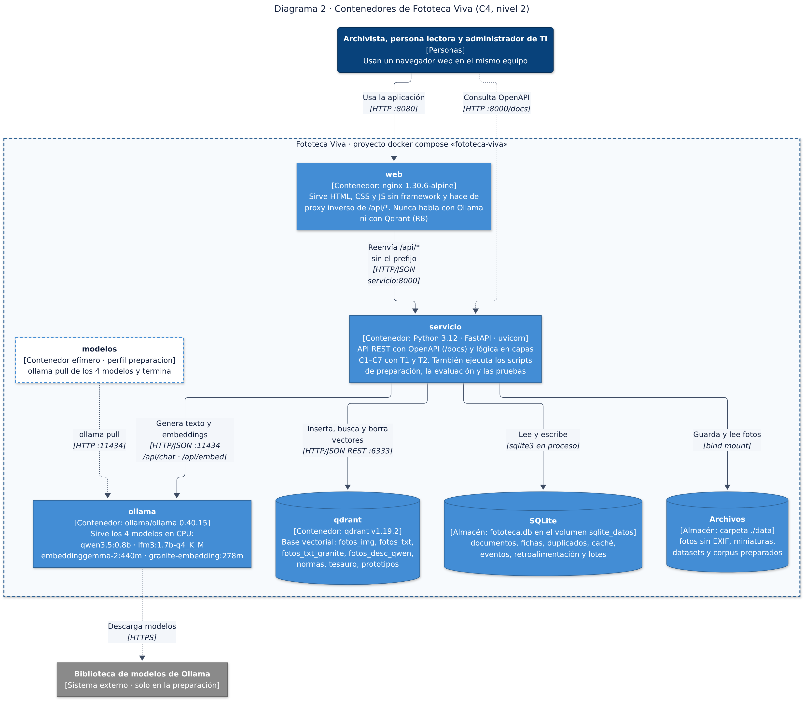
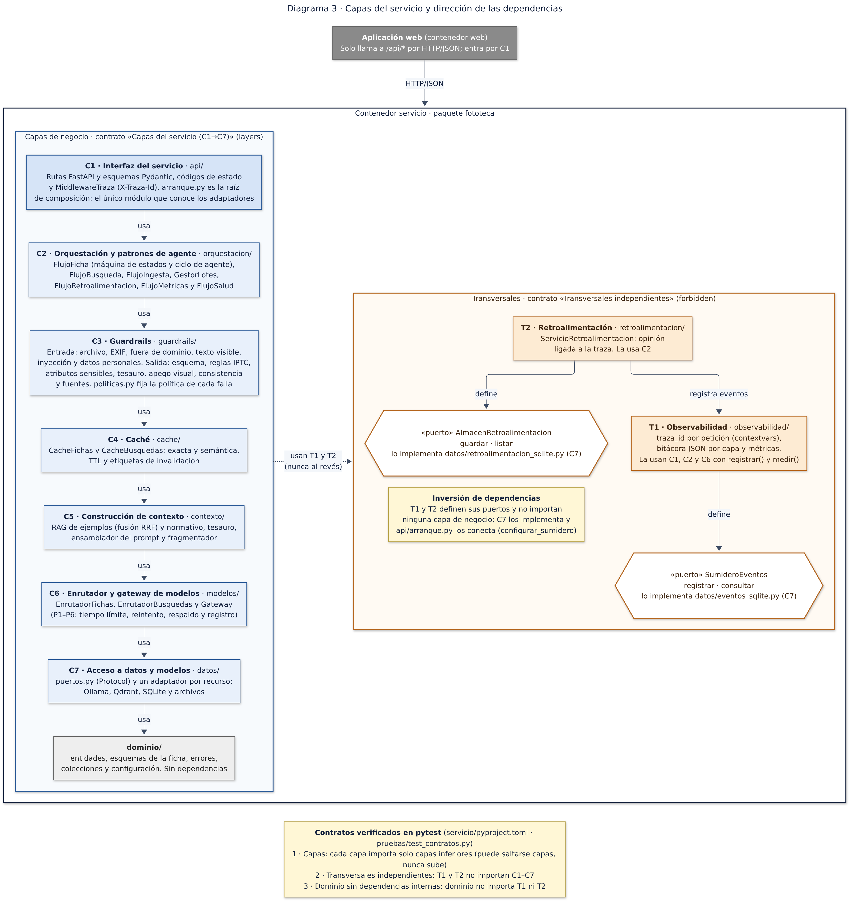

# Fototeca Viva · Reporte de estado previo a la demostración

**Proyecto integrador, Unidad II · Tópicos Selectos de Arquitectura de Software · MCIT, UPChiapas**

**Autor:** Ramsés Alejandro Camas Nájera · **Fecha:** 7 de noviembre de 2026

**Repositorio:** https://github.com/RamsesCamas/ProyectoIntegrador-ArqSoftware-U1-Fototeca-Inteligente

**Demostración:** sábado 14 de noviembre de 2026, en clase. El informe técnico completo se entregará después.

## 1. Por qué este proyecto

Las universidades y los periódicos guardan miles de fotografías con poca o ninguna descripción. Sin metadatos, una
foto no se puede encontrar. Sin texto alternativo, una persona que usa lector de pantalla no puede saber qué
muestra, aunque WCAG 2.2 (criterio 1.1.1) lo exige. Catalogar a mano es lento, y el resultado depende de quién lo
haga. Estándares como IPTC Photo Metadata definen qué llenar, pero casi nadie los llena completos.

**Fototeca Viva** propone, para cada foto, una **ficha catalográfica IPTC completa**: titular, descripción, texto
alternativo de 250 caracteres o menos, descripción extendida y palabras clave normalizadas al Tesauro de la UNESCO.
Tiene tres rasgos que la distinguen:

- **Trazabilidad:** cada campo indica su fuente, que puede ser una regla de la norma, una foto parecida ya
  catalogada o un término del tesauro.
- **Aprende de las correcciones del archivista sin *fine-tuning*:** cada ficha validada se vuelve un ejemplo que el
  sistema recupera para las fotos siguientes (RAG).
- **No es un chatbot:** entrega fichas, reportes de casi duplicados y búsquedas por texto o por foto, cada resultado
  con sus razones.

Una restricción de diseño marca todo el proyecto: el sistema corre **completo en local, en CPU y sin servicios en la
nube**. Los archivos institucionales manejan colecciones sensibles. Por eso, además, la ingesta elimina los datos GPS
y de autor de las fotos, la ficha nunca identifica personas ni infiere atributos sensibles, y la interfaz advierte
que el contenido lo genera un modelo.

## 2. Arquitectura y decisiones principales

**Cuatro contenedores con Docker Compose:**

| Contenedor | Rol | Límite de memoria |
|---|---|---|
| `ollama` | Sirve los cuatro modelos en CPU | 5 GiB |
| `qdrant` | Base vectorial | 512 MiB |
| `servicio` | API FastAPI en capas | 1.5 GiB |
| `web` | nginx con la aplicación estática | 64 MiB |

Los cuatro límites suman 7.0625 GiB, así que el sistema cabe en una laptop con 8 GB para Docker. La web solo habla con
la API por HTTP.

**Capas estrictas.**
- La API (C1) depende de la orquestación (C2). La orquestación usa los guardrails (C3), la caché (C4), el contexto
  (C5), los modelos (C6) y los adaptadores de datos (C7).
- La observabilidad (T1) y la retroalimentación (T2) son transversales y se conectan por inversión de dependencias.
- Una prueba automática con *import-linter* rompe la compilación si alguna capa importa una superior.

**Cuatro modelos, cada uno con un papel:**

| Modelo | Papel |
|---|---|
| Qwen3.5-0.8B (visión) | Describe la imagen y genera la ruta rápida |
| LFM3-1.7B | Compone la ficha a partir de la descripción y del contexto recuperado |
| EmbeddingGemma-2 | Pone texto e imagen en el mismo espacio. Lo usan la búsqueda, los duplicados y la caché semántica |
| granite-embedding | Segundo embedding, para auditar la consistencia y para comparar arquitecturas |

**RAG con tres fuentes:**
- fotos parecidas ya catalogadas, fusionadas con RRF a partir de la búsqueda imagen→imagen e imagen→texto;
- reglas de IPTC, W3C WAI, WCAG y DCMI, con una regla por fragmento;
- el Tesauro de la UNESCO, con un concepto por documento.

**Enrutador de fichas:**
- **Ruta rápida.** Qwen ve la imagen y las fichas vecinas. Se usa cuando los vecinos coinciden entre sí.
- **Ruta completa.** Qwen describe la imagen y LFM3 compone la ficha. Se usa cuando no hay consenso o cuando la foto
  contiene texto escrito.

**Ciclo de agente.** Si la recuperación de ejemplos es pobre, el sistema reformula hasta dos veces: describe la foto,
busca esa descripción como texto y fusiona los resultados.

**Caché y guardrails.**
- **Caché exacta y semántica en dos niveles.** Una foto recortada o recomprimida se reconoce como «posible duplicado»
  y no vuelve a pasar por los modelos.
- **Guardrails de entrada y de salida, cada uno con su política.** Las políticas son bloquear, sanitizar, marcar o
  reintentar.
- **Entrada:** EXIF y GPS, fotos fuera de dominio, inyección de instrucciones en el texto y dentro de la imagen, y
  datos personales en las búsquedas.
- **Salida:** reglas IPTC, apego visual del texto alternativo, consistencia, atributos sensibles, normalización al
  tesauro y validez de las fuentes citadas.

**Documentación.** Cada decisión está registrada en un ADR (13 en total) y hay 10 diagramas.

## 3. Retos técnicos y cómo se resolvieron

**Multimodalidad local.**
- La variante `270m` de EmbeddingGemma-2 no acepta imágenes en Ollama: responde con un error 501.
- Se adoptó la variante `440m`, que pone texto e imagen en el mismo espacio. En la prueba de 50 pares
  foto-descripción, el par correcto quedó primero en el 100 % de los casos.
- Sus embeddings de texto son idénticos a los de `270m` (ADR-10).

**Modelos pequeños que deben responder en JSON válido.**
- Con el muestreo sin penalización de repetición, Qwen caía en listas repetidas y cortaba el JSON: 3 de 5 respuestas
  válidas.
- Con su penalización recomendada, la salida forzada por JSON Schema y un prompt más breve, quedaron 5 de 5.
- Se desactivó el modo de razonamiento («thinking»). Con él activo, LFM3 no produjo ningún JSON válido (0 de 3) y su
  latencia mediana subió 107 % (ADR-11).

**Latencia en CPU.**
- Describir una imagen tarda decenas de segundos: P1 tiene una mediana de 34.28 s con imágenes de 512 px. Componer la
  ficha con LFM3 tarda 39.351 s de mediana.
- Se eligió 512 px porque su calidad quedó a menos de 0.02 de la mejor y cuesta menos.
- La arquitectura reduce las llamadas a los modelos: la ruta rápida, la caché semántica y los lotes asíncronos con un
  solo trabajador.

**Memoria.** Cuatro modelos tienen que caber en 5 GiB.
- El motor de Ollama (llama-server) reserva por defecto hasta 8,192 MiB de caché de prompts por modelo. Con cuatro
  modelos, el contenedor llegó a su límite y el sistema operativo terminó un proceso.
- Al desactivar esa caché, el pico quedó en 4.592 GiB (ADR-12).

**Medir con honestidad.**
- Esa misma caché hacía que las peticiones repetidas respondieran sin recalcular la imagen, lo que falseaba las
  latencias.
- Se detectó y las mediciones se repitieron con la caché desactivada.
- En los documentos, cada cifra sale de un archivo de resultados del repositorio.
- Los umbrales se calibran con conjuntos propios de calibración, separados de los de evaluación, para que la
  evaluación quede fuera de muestra. Por ejemplo, la heurística que detecta instrucciones escritas dentro de una
  imagen no se ajustó con los casos de evaluación: lo que no detecta lo cubre una segunda capa por similitud
  semántica, y la eficacia de ambas se mide en la evaluación.

**Dos idiomas.** Las etiquetas de Open Images están en inglés y el Tesauro de la UNESCO se usa en español. El cruce se
hace por embeddings, con un umbral calibrado a partir de las etiquetas cuya traducción se conoce.

## 4. Estado actual

**Implementado y verificado con pruebas automáticas** (unitarias, de API con modelos simulados, de contrato de capas y
de guardrails con los casos reales de los conjuntos de evaluación). Todas pasan. La web tiene además pruebas de punta a
punta con Playwright:
- Catalogación (sencilla y por lotes), búsqueda por texto y por foto, carga y eliminación de documentos,
  retroalimentación con validación de fichas, métricas y reporte de duplicados.
- Aplicación web de seis páginas, accesible.
- API documentada con Swagger, que también funciona sin conexión.

**Viabilidad en CPU, medida.** Los cuatro modelos están cargados a la vez dentro del límite de memoria. Las latencias y
los ajustes se documentan en los ADR-10 a ADR-12.

**Datos y corpus, preparados.**
- Archivo fotográfico: Crossmodal-3600, con 3,600 fotos de 36 regiones y descripciones humanas en español. Ya están
  calculados los embeddings de imagen de las 3,600 fotos.
- Particiones con semilla fija: archivo ya catalogado (2,600 fotos), fotos nuevas por catalogar (700) y regiones que el
  archivo no tiene (300 fotos de las locales `ja`, `ko` y `sv`, elegidas por tener la menor similitud media con el
  resto; sirven para probar el ciclo de agente).
- De ellas salen la galería de búsqueda (1,000 fotos) y las 60 fotos de evaluación de fichas.
- Conjuntos de evaluación versionados en el repositorio, para que cualquier equipo evalúe exactamente los mismos
  casos: casi duplicados, inyección de instrucciones en imágenes, capturas fuera de dominio, fotos con GPS sintético,
  consultas complejas y consultas para los guardrails, más conjuntos separados para calibrar.
- Los datos descargados ocupan 0.71 GB.
- Corpus normativo: 13 documentos, que suman 412 fragmentos y unas 88.6 páginas.
- Tesauro de la UNESCO: 4,500 conceptos.

**Demostración (14 de noviembre, sin conexión a internet)** en nueve pasos:
1. Todo local.
2. Catalogar una foto y ver la fuente de cada campo.
3. La misma foto recortada, detectada por la caché semántica.
4. El bloqueo de una captura de documento.
5. El ciclo de agente con una foto de una región que el archivo no tiene.
6. Validar una ficha corregida.
7. Búsqueda simple y compleja.
8. El panel de métricas.
9. La API.

**Después de la demostración:**
- la evaluación cuantitativa completa: comparación de modelos y de arquitecturas de búsqueda (R3) y calidad por capa
  (R9);
- el informe técnico final en PDF.

El repositorio incluye la guía para reproducirlo todo (`docs/EJECUCION.md`).

---
*Fuentes de las cifras: en `evaluacion/resultados/`, `h0.json`, `h0_llama_server_cache_ram.txt`, `corpus_r1.json` y
`datos.json`; las particiones, en `evaluacion/conjuntos/particiones.json`; los límites de memoria, en
`docker-compose.yml`.*
